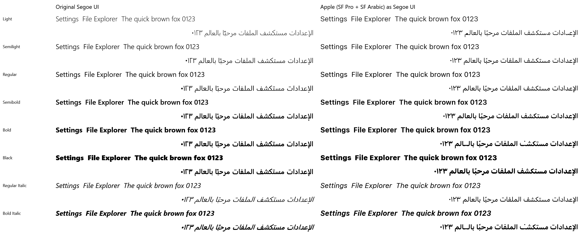
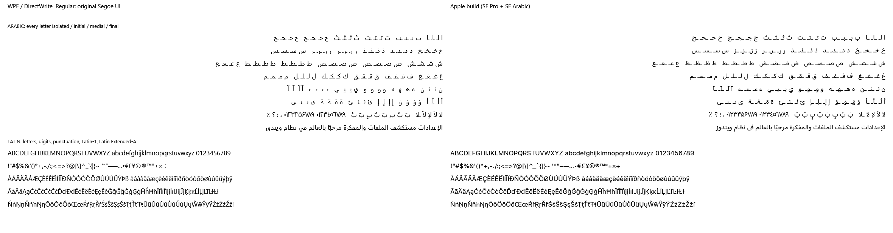
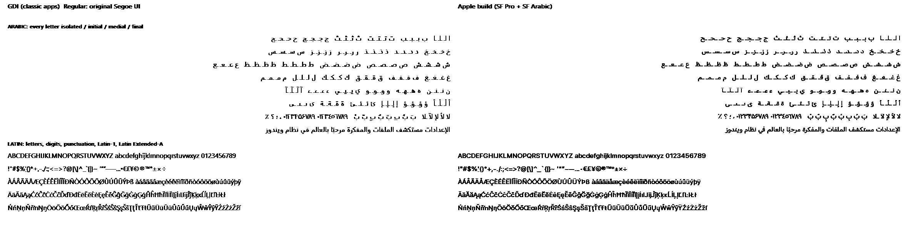
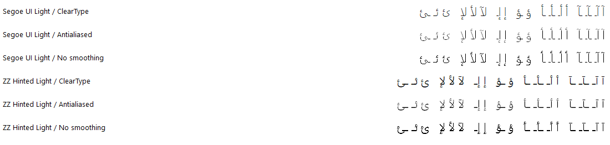

# Validation

Everything below was run against release **v1.0.0** before it touched a real PC.
Reports: [`reports/validation-report.txt`](reports/validation-report.txt),
[`reports/render-all-glyphs.txt`](reports/render-all-glyphs.txt).

## Provenance of the Apple fonts

- All 8 installers from `devimages-cdn.apple.com` passed `pkgutil --check-signature` ("signed Apple Software").
- The 155 extracted fonts are **byte-identical** to the 99 the Mac has in `/Library/Fonts` (where it has them).
- The third-party SFWindows repo matched Apple for 117 files, but its **38 SF Compact files were an older build**
  (22.0d4e4 vs Apple's 22.0d5e4), so the release ships Apple's originals, not SFWindows'.
- `build/fetch_apple_fonts.sh` reproduces all 155 files byte-for-byte (checked against `fonts/SHA256SUMS.txt`).

## Built UI fonts: `validation/validate_ui_fonts.py`, 311 / 311 hard checks pass

Per font (13 files):

| Check | Result |
|---|---|
| OpenType Sanitizer (the validator Chrome and Firefox use) | pass |
| Every table decompiles (fontTools) | pass |
| Layout script/language/feature records sorted by tag | pass |
| `name` table identical to the Segoe file it replaces | pass |
| Weight class, `fsSelection`, `macStyle`, win/typo/hhea line metrics identical to Segoe | pass |
| Segoe UI Variable: axes and all 15 named instances identical to Segoe | pass |
| **Every glyph point-identical to Apple's outline** (35,707–37,443 glyphs per file; largest shift 1.5/2048 em, which is rounding) | pass |
| Everyday Latin (Basic, Latin-1, Extended-A), punctuation, Euro and the Arabic block drawn by the Apple font itself | pass |
| No character Segoe could draw ends up with no font at all (DirectWrite fallback and GDI font linking) | pass |
| English / Arabic / Hebrew / Greek / Cyrillic samples shape with no missing glyphs; Arabic letters join | pass |

Text width vs Segoe for the same sample: English 1.06–1.15× (SF Pro is a little wider), Arabic 0.67–1.04×.

## Rendering every glyph with Windows' own engines

`validation/render_all_glyphs.py`: each of the 13 fonts loaded privately (not installed). **Every glyph**
was drawn with GDI at 12, 16 and 20 px and outlined with WPF. **0 blank glyphs** across about 480,000 glyphs × 4 renders.
A positive control (a copy with 3 glyphs deliberately emptied) is caught, so the test can fail.

`validation/winload.ps1`: all 13 fonts and all 155 Apple fonts load in GDI (`AddFontResourceEx`) and WPF
with the expected family and face names.

## Visual checks

Full specimen sheets: every Arabic letter in all four joining forms, lam-alef, harakat, Arabic and
Persian digits, all of Basic Latin, Latin-1 and Latin Extended-A, drawn with WPF and with GDI:

Arabic hamza and madda marks at real UI size (21 px at 175 %), ClearType, antialiased, and no smoothing:

## Emoji coverage: `build/emoji_coverage.py`

Each of the 3,963 fully qualified emoji in Unicode 18.0 was shaped to one glyph or not:

| Unicode emoji version | Segoe UI Emoji (Win 11 25H2) | Apple build |
|---|---:|---:|
| 0.6 – 5.0 (core set) | 2,331 | 2,623 |
| 11.0 – 15.1 | 850 | 1,150 |
| 16.0 | 7 | 8 |
| 17.0 | 43 | 163 |
| 18.0 | 0 | 0 (not in macOS 27 either) |
| **Total** | **3,231** | **3,944** |

**0 emoji that Windows can show are missing from the Apple build.** The emoji font's names and line
metrics are identical to Segoe UI Emoji.

## On the real PC after install + restart (`status.ps1`)

Every UI family resolves to the SFUI-* files, all 13 match the verified builds, and the Search panel,
Start, Taskbar, Settings, File Explorer and emoji were confirmed visually.
